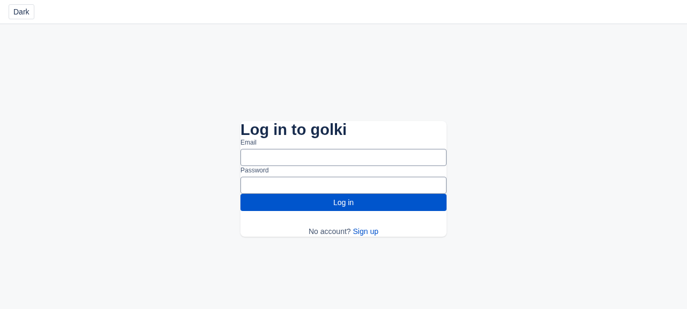
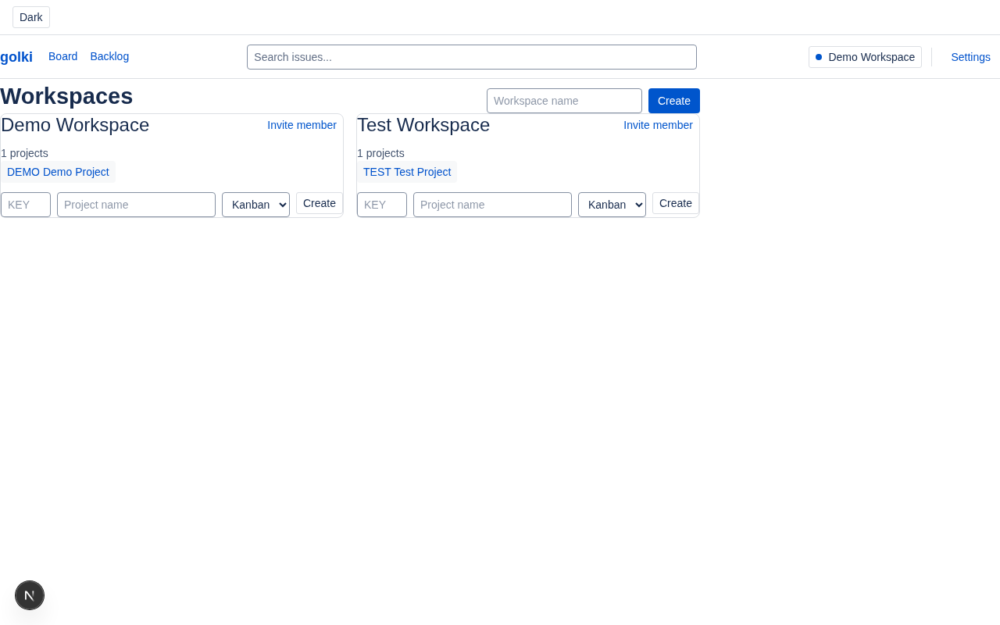
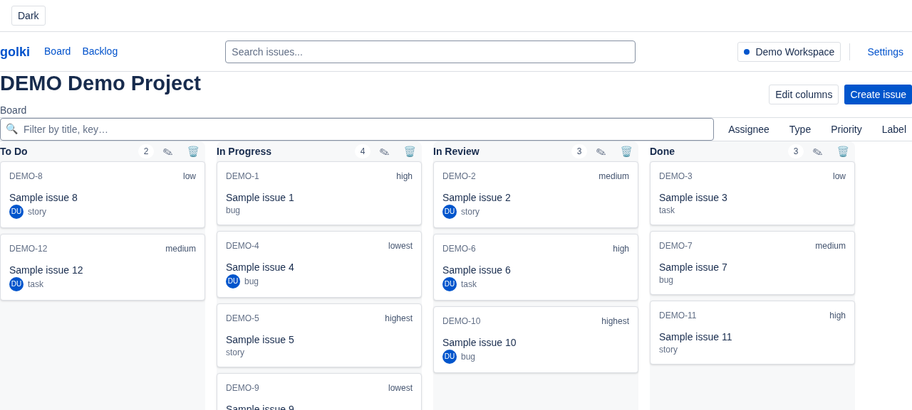
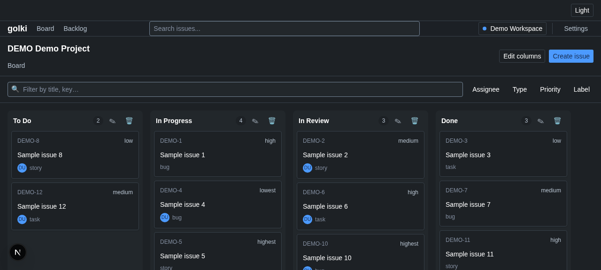
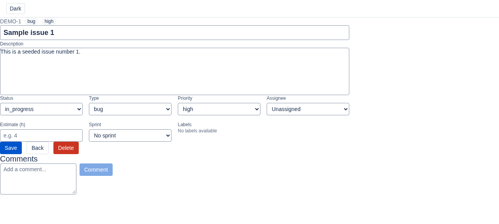
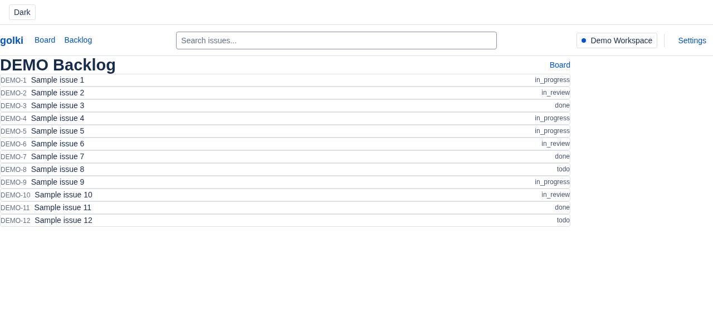
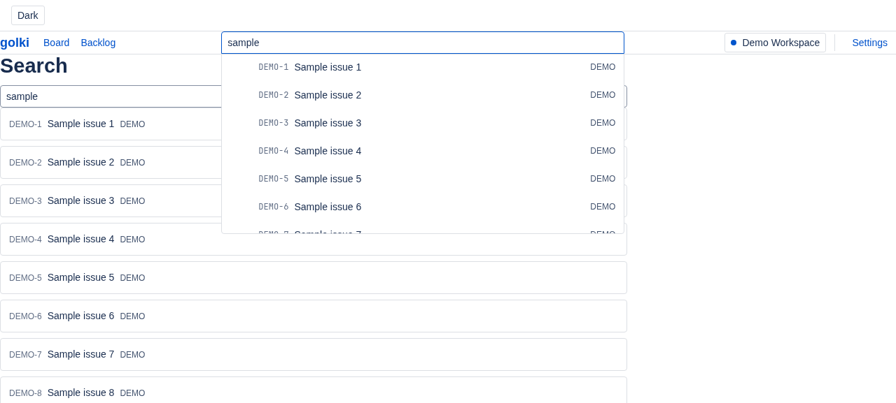

# golki — Jira clone

A Jira clone matching the Atlassian Design System (ADS), built with Next.js 16, React 19, TypeScript (strict), Tailwind CSS v4, Biome, Prisma + Postgres, and `@atlaskit/pragmatic-drag-and-drop`.

## Demo video

https://github.com/paramcodes/golki/raw/master/docs/demo.mp4

## Features

- **Auth** — sign up / log in (credentials), protected routes.
  - 
- **Workspaces & projects** — create workspaces, create projects with keys.
  - 
- **Kanban board** — columns by status, drag-and-drop cards (pragmatic-dnd), counts, filters-ready.
  - 
  - 
- **Issue detail** — edit title/description/status/priority, comments.
  - 
- **Backlog** — list issues, sprint context.
  - 
- **Search** — search issues by title/key.
  - 
- **Dark mode** — Atlassian tokens, toggle in header.
- **Design system** — ADS tokens (color, space, radius, typography, elevation), light/dark.

## Tech stack

Next.js 16 (App Router), React 19, TypeScript strict, Tailwind v4, Biome, Vitest, Prisma + Postgres, next-auth v5, zod, zustand, TanStack Query, agent-browser + Lightpanda (E2E).

## Getting started

```bash
bun install
cp .env.example .env   # or create .env with DATABASE_URL
docker run -d --name golki-pg -e POSTGRES_USER=golki -e POSTGRES_PASSWORD=golki -e POSTGRES_DB=golki -p 5432:5432 postgres:16-alpine
bun run db:push
bun run db:seed
bun run dev
```

Open http://localhost:3000. Demo account: `demo@golki.dev` / `password123`.

## Scripts

- `bun run dev` — dev server
- `bun run build` — production build
- `bun run typecheck` — tsc --noEmit
- `bun run check` — Biome lint+format
- `bun run test` — Vitest
- `bun run e2e` — agent-browser + Lightpanda smoke
- `bun run db:push` / `db:seed` / `db:studio`

## E2E

Fast path uses Lightpanda (9x faster, 16x less RAM than Chrome) via `AGENT_BROWSER_ENGINE=lightpanda`. Chrome fallback available.

## Performance

- E2E smoke: Lightpanda renders login in <1s (vs ~46s/2GB for Chrome on 100 pages per Lightpanda benchmarks).
- Biome check: ~200ms on 58 files.
- Build: all routes prerender/dynamic in ~seconds.

## License

MIT
